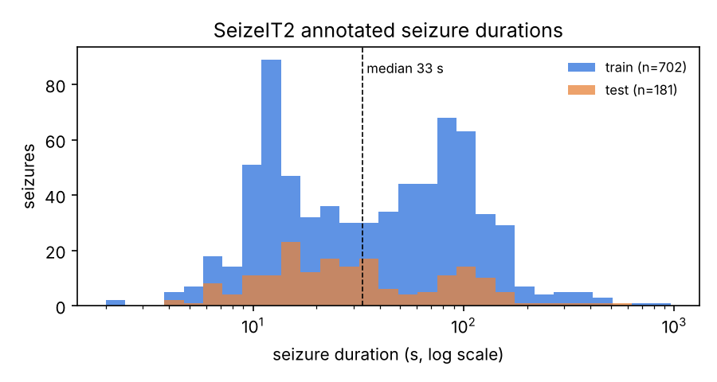
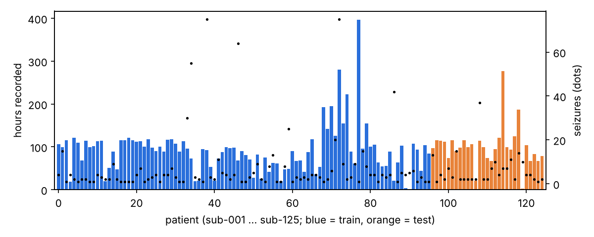
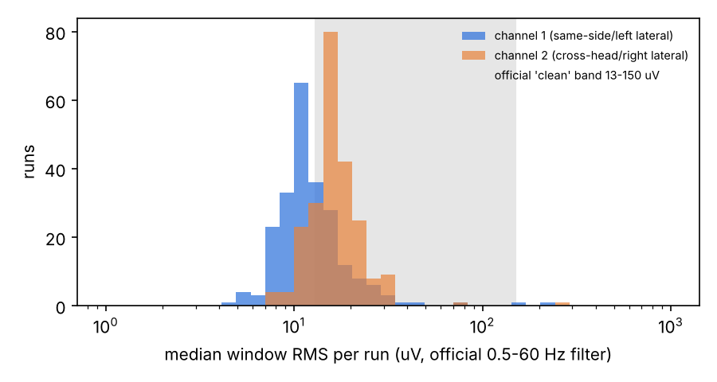

# M1 data audit: SeizeIT2 (OpenNeuro ds005873)

Generated by `python scripts/audit_data.py` at commit `eb43600`. Every number below is computed from the files; tables are in `results/audit/`, summary numbers in `reports/data_audit.json`.

Dataset version 1.1.0 (DOI 10.18112/openneuro.ds005873.v1.1.0), licence CC0. Bucket listing: 24877 objects, 125.9 GB.

## 1. Contradictions with Section 3 of the prompt

| Item | Prompt says | Files say | Consequence |
|---|---|---|---|
| Sampling rate of EEG/ECG/EMG | 250 Hz | ECG: 256 Hz in 2804 files, EEG: 256 Hz in 2850 files, EMG: 256 Hz in 2804 files | Never hard-code 250. Windows are defined in seconds; integer filters must be designed for 256 Hz (or resampled, which costs logic). The official baseline resamples to 250 Hz. |
| Motion channels | 3-axis ACC and GYR from the chest module | 8 channel layouts; 12 channels (ACC+GYR of both the EEG module and the chest module) in 2308 of 2551 runs; full chest ACC+GYR in 2489 runs | Use chest ACC+GYR when present; treat missing axes as a missing sub-modality (present bit = 0). |
| Number of seizures | 886 (train 704, test 182) | 883 (train 702, test 181) | Report our count; cite the paper's count with a footnote. |
| Seizure types | 317 FA, 393 FIA, 55 FBTC, 12 unclear awareness, 2 subclinical, 93 unknown onset | FIA 391, FA 316, focal_unknown_awareness 115, FBTC 55, unknown_onset 6 | No `subclinical` level exists in events.json; per-type breakdowns use the classes found. |
| Shortest seizure | 3 s | 2 s (2 seizures under 3 s) | Keep; a 2 s seizure can still be one positive window. |
| Female patients | 51 | 62 in participants.tsv | Check with the authors; the paper text and the file disagree. |
| Total recording | 11640 h | 11,626 h of EEG | Minor (0.1%). |
| Centre and age per patient | used for stratified folds, leave-one-centre-out, centre and adult/child breakdowns | not in the public release (participants.tsv columns: ['participant_id', 'sex']); not in sidecars or EDF headers | Inner folds are stratified by seizure count only. Centre/adult-child analyses are blocked until the authors provide the mapping. |
| Seizure visibility on the wearable | secondary result on visible seizures 'if the annotation supports it' | `channels` is n/a for 883 of 883 seizures; `confidence` n/a for 883 | The annotation does not support it: drop the visible-only secondary result (or ask the authors). |
| Session folder | ses-001 | ses-01 | Loader reads whatever session folder exists. |
| Dataset version / DOI | v1.0.0 | v1.1.0 (CHANGES: 1.1.0 corrected accelerometer data) | Cite 10.18112/openneuro.ds005873.v1.1.0. |
| Gaps inside files | recordings have gaps and runs | {'EDF+C': 11009}; sidecars say RecordingType=discontinuous but every EDF is continuous; signal audit found 0 record gaps in 229 files read | Gaps exist only between runs; treat each run as continuous, never cross a file boundary. |

## 2. Inventory

| Quantity | Value |
|---|---|
| Patients | 125 (62 female per participants.tsv); train 96, test 29 |
| Runs (EEG files) | 2850 |
| Files per modality (.edf) | EEG 2850, ECG 2804, EMG 2804, MOV 2551 |
| Hours per modality | EEG 11,626.2, ECG 11,270.9, EMG 11,270.9, MOV 11,173.3 |
| Runs shorter than 10 min | 31 |
| Hours per patient (min / median / max) | 1.1 / 95.0 / 397.1 |
| Seizure time | 14.33 h = 0.123% of EEG time (positive-window rate before augmentation) |
| Patients without a seizure | none |
| Impedance-check (`impd`) events | 464 events, 27.4 h (positive durations only); official code treats them as background |
| Malformed events (duration <= 0) | sub-031 run-07: impd@51968s dur -40258s;impd@52025s dur -35020s; sub-042 run-04: impd@16606s dur 0s; sub-043 run-02: impd@37799s dur -28796s;impd@37895s dur -82s;impd@38306s dur -11s; sub-046 run-07: impd@37018s dur 0s; sub-103 run-06: impd@5511s dur 0s; sub-115 run-48: impd@1198s dur 0s; sub-115 run-50: impd@1211s dur 0s |
| Sidecar vs EDF sampling rate disagreements | 0 |
| Sidecar EEGMontage agrees with EDF channel labels | 2850 of 2850 runs |

### Sampling rates found

| Modality | Sidecar (Hz) | EDF header (Hz) | Files |
|---|---|---|---|
| ECG | 256 | 256 | 2804 |
| EEG | 256 | 256 | 2850 |
| EMG | 256 | 256 | 2804 |
| MOV | 25 | 25 | 2551 |

Files that differ from the nominal 250 Hz / 25 Hz: EEG 2850 of 2850, ECG 2804 of 2804, EMG 2804 of 2804, MOV 0 of 2551. The per-file list is `results/audit/runs.csv` (columns `fs_*`).

## 3. EEG montages

| Montage (from EDF labels) | Channels | Runs | Sidecar EEGMontage |
|---|---|---|---|
| left | BTEleft SD + CROSStop SD | 1434 | left |
| right | BTEright SD + CROSStop SD | 906 | right |
| bilateral | BTEleft SD + BTEright SD | 510 | generalized |

Patients by montage set: bilateral: 16, left: 65, left|right: 2, right: 42. A patient whose montage changes between runs means channel position is not even fixed within a patient.

## 4. Missing modalities

| Modality | Runs missing | Hours missing | Share of EEG time |
|---|---|---|---|
| ECG | 46 | 355.3 | 3.1% |
| EMG | 46 | 355.3 | 3.1% |
| MOV | 299 | 453.0 | 3.9% |

Motion channel layouts (label set, unit, runs):

| Channels | Unit | Runs |
|---|---|---|
| EEG SD ACC X, EEG SD ACC Y, EEG SD ACC Z, EEG SD GYR A, EEG SD GYR B, EEG SD GYR C, ECGEMG SD ACC X, ECGEMG SD ACC Y, ECGEMG SD ACC Z, ECGEMG SD GYR A, ECGEMG SD GYR B, ECGEMG SD GYR C | g | 2308 |
| EEG SD ACC X, EEG SD ACC Y, EEG SD ACC Z, ECGEMG SD ACC X, ECGEMG SD ACC Y, ECGEMG SD ACC Z, ECGEMG SD GYR A, ECGEMG SD GYR B, ECGEMG SD GYR C | g | 94 |
| ECGEMG SD ACC X, ECGEMG SD ACC Y, ECGEMG SD ACC Z, ECGEMG SD GYR A, ECGEMG SD GYR B, ECGEMG SD GYR C | g | 87 |
| EEG SD ACC X, EEG SD ACC Y, EEG SD ACC Z, EEG SD GYR A, EEG SD GYR B, EEG SD GYR C | g | 31 |
| EEG SD ACC X, EEG SD ACC Y, EEG SD ACC Z | g | 20 |
| EEG SD ACC X, EEG SD ACC Y, EEG SD ACC Z, ECGEMG SD ACC X, ECGEMG SD ACC Y, ECGEMG SD ACC Z | g | 9 |
| EEG SD ACC X, EEG SD ACC Y, EEG SD ACC Z, ECGEMG SD ACC X, ECGEMG SD ACC Y, ECGEMG SD ACC Z | 10E-3 g | 1 |
| EEG SD ACC X, EEG SD ACC Y, EEG SD ACC Z, EEG SD GYR A, EEG SD GYR B, EEG SD GYR C, ECGEMG SD GYR A, ECGEMG SD GYR B, ECGEMG SD GYR C | g | 1 |

## 5. Seizures

| Class | Train | Test | Total |
|---|---|---|---|
| FIA | 289 | 102 | 391 |
| FA | 274 | 42 | 316 |
| focal_unknown_awareness | 105 | 10 | 115 |
| FBTC | 33 | 22 | 55 |
| unknown_onset | 1 | 5 | 6 |
| all | 702 | 181 | 883 |

Duration: min 2 s, median 33 s, mean 58.4 s, max 962 s; 87 seizures shorter than 10 s, 15 longer than 5 min.

* Overlapping annotated seizures within a run: 4 pairs; consecutive seizures less than 90 s apart: 27 pairs. Under the SzCORE 90 s merge rule the 883 annotations become 852 reference events (approximate count; the exact count is produced by `timescoring` in M2).
* Seizures outside their run's duration: 0.
* Seizures starting within the first hour of a run: 201 (relevant for N3, which adapts on the first H hours).
* Lateralization: left 386, un 376, right 112, bi 9; vigilance: awake 426, asleep 367, un 90. These are annotations and are never fed to a model (Section 7.2).

## 6. Signal quality (flat-lines, saturation, artefact rate)

From `scripts/audit_signals.py`: 229 of 11009 EDF files measured (EEG 229/2850), (ECG 0/2804), (EMG 0/2804), (MOV 0/2551).

| Modality | Files | Flat spans >= 1 s | Flat time (channel-hours) | Flat spans >= 10 s | Longest flat span | Saturated samples |
|---|---|---|---|---|---|---|
| EEG | 229 | 307 | 15.8 h (0.3%) | 24 | 293.7 min | 0.0001% |

**Official RMS artefact rule** (window RMS outside 13-150 uV after the official 0.5-60 Hz + 50 Hz notch filter, 2 s windows, 1 s hop; filtered at the file's 256 Hz rather than after resampling to 250 Hz):

| Channel | Windows flagged | Median of per-run median RMS |
|---|---|---|
| channel 1 (BTEleft, else BTEright) | 61.5% | 11.2 uV |
| channel 2 (CROSStop, else BTEright) | 31.4% | 16.0 uV |
| either channel flagged | 66.2% |  |
| both channels flagged | 26.7% |  |

The 13 uV floor is close to the typical RMS of a behind-the-ear channel, so the rule flags a large share of ordinary windows. The official evaluation code computes `rmsa = rmsa_f and rmsa_c` on two Python lists, which returns only the cross-channel list, so in practice the published baselines gate on channel 2 alone. M2 reproduces that behaviour for the baselines; the artefact flag of our own models is a design decision for M3 (see `results/decisions.md`).

Per-channel numbers: `results/audit/signal_channels.csv`.

## 7. What M2/M3 must do differently because of this audit

1. Design every filter and window for 256 Hz read from the header; test the 250 Hz path too (fixtures cover both).
2. Stratify inner folds by seizure count only until centre labels arrive; keep the centre/adult-child tables as placeholders.
3. Drop the visible-seizure secondary result unless the authors can supply visibility labels.
4. Motion features need a per-axis present mask: chest ACC/GYR are not always there, and the EEG-module motion is an extra source.
5. Report SzCORE metrics on the reference events after `timescoring`'s 90 s merge, and state the annotation count we used.
6. Revisit the 13 uV artefact floor for our own models: feed the flag as an input bit, do not gate on it blindly.

