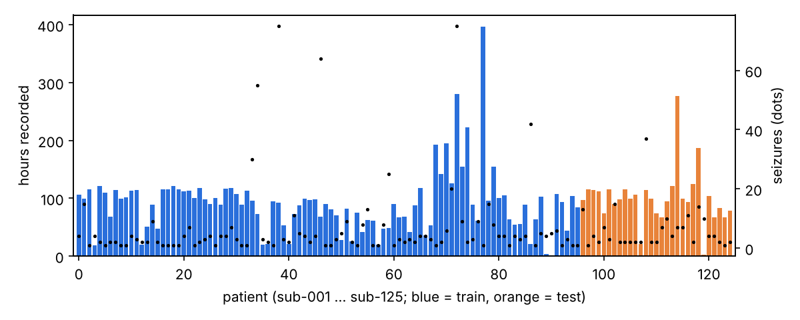
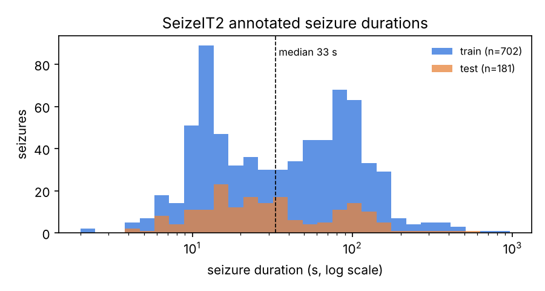

# Chapter 3. Dataset and data audit

## 3.1 SeizeIT2

We use SeizeIT2 (Bhagubai et al., *Scientific Data* 12:1228, 2025), a public multimodal wearable dataset of
patients with focal epilepsy, released on OpenNeuro as ds005873 (version 1.1.0, DOI 10.18112/openneuro.ds005873.v1.1.0,
licence CC0). The patients were monitored in the epilepsy monitoring units of five European centres (Leuven, Coimbra,
Freiburg, Karolinska and Aachen) with the Sensor Dot wearable, while the hospital video-EEG was recorded for the
clinical annotation of every seizure. The wearable records four modalities:

| Modality | Module (from the channel labels) | Channels | Sampling rate (measured) |
|---|---|---|---|
| EEG | EEG module, electrodes behind the ears (bte-EEG) | 2: BTEleft, BTEright or a cross-head channel (CROSStop) | 256 Hz |
| ECG | ECG/EMG module | 1 | 256 Hz |
| EMG | ECG/EMG module | 1 | 256 Hz |
| Motion | ECG/EMG module and EEG module | 3-axis accelerometer + 3-axis gyroscope per module | 25 Hz |

The dataset defines the split we follow: **96 training patients (sub-001 to sub-096) and 29 test patients
(sub-097 to sub-125)**, balanced by the authors for seizure count, data amount, centre and seizure type. All our
model development uses only the 96 training patients, with 5-fold patient-wise cross-validation inside them; the
29 test patients are scored once, at the end (Phase 2).

## 3.2 Why a data audit

Before writing any model code we measured every file of the release (11,009 EDF files, 125.9 GB) instead of
trusting the documentation, because a hardware pipeline has to be designed for the exact sampling rates, signal
ranges and missing channels. The audit streams each file from the public S3 bucket, measures it and deletes it, so
it needs no local copy of the dataset. Every number in this chapter is computed from the files
(`reports/data_audit.md`, tables in `results/audit/`).

## 3.3 Inventory

| Quantity | Value |
|---|---|
| Patients | 125 (train 96, test 29) |
| Recordings (runs) | 2,850 |
| Files per modality | EEG 2,850, ECG 2,804, EMG 2,804, motion 2,551 |
| Hours of EEG | 11,626 h (median 95 h per patient, range 1.1–397 h) |
| Seizures | 883 (train 702, test 181) |
| Seizure time | 14.3 h = **0.123 % of the recording time** |
| Seizure duration | 2 s to 962 s, median 33 s; 87 shorter than 10 s |
| Missing ECG / EMG | 46 runs (3.1 % of the time) |
| Missing motion | 299 runs (3.9 % of the time) |

| Seizure class | Train | Test | Total |
|---|---|---|---|
| Focal impaired awareness (FIA) | 289 | 102 | 391 |
| Focal aware (FA) | 274 | 42 | 316 |
| Focal, awareness unknown | 105 | 10 | 115 |
| Focal to bilateral tonic-clonic (FBTC) | 33 | 22 | 55 |
| Unknown onset | 1 | 5 | 6 |

Two facts shape the whole project. First, seizures are rare: 0.123 % of the time, so a detector that never fires is
99.88 % "accurate", and accuracy is useless as a metric (Chapter 4.6). Second, most seizures are focal (only 55 of
883 are tonic-clonic), and focal seizures are the hardest to see on two behind-the-ear electrodes.

## 3.4 Where the files differ from the documentation

| Item | Documentation | Files | What we did |
|---|---|---|---|
| Sampling rate of EEG/ECG/EMG | 250 Hz | **256 Hz** in every file | All windows are defined in seconds; every integer filter is designed for 256 Hz |
| Number of seizures | 886 (train 704, test 182) | **883** (train 702, test 181) | We report our count and cite the paper's |
| Seizure classes | includes "subclinical" | no such class in the event files | Breakdowns use the classes present |
| Shortest seizure | 3 s | 2 s | Kept |
| Female patients | 51 | 62 in `participants.tsv` | Reported as a discrepancy |
| Centre and age per patient | used for stratification | **not in the public release** | Folds stratified by seizure count only |
| Seizure visibility on the wearable | expected | not annotated (all 883 n/a) | Visible-seizure analysis dropped |
| Gaps inside files | "discontinuous" | every EDF is continuous | Gaps exist only between runs; a window never crosses a file boundary |

## 3.5 Signal quality

* **Artefact rule of the official baseline.** The baseline discards windows whose RMS is outside 13–150 µV. On
  behind-the-ear channels the typical RMS is close to the 13 µV floor (median per-run RMS 8.0 µV and 12.1 µV for
  the two channels), so the rule flags 69 % and 47 % of ordinary windows. We also found that the released
  evaluation code combines the two channels with a Python `and` on two lists, which returns only the second list,
  so in practice only one channel is gated. We reproduce this behaviour for the baseline and, for our own models,
  feed the artefact flags as input bits instead of gating blindly (decision D21).
* **Motion sensors** are exactly constant for 22.8 % of channel time (sensor idle), so a flat motion signal does not
  mean a missing file; presence bits come from file availability.
* **Truncated downloads.** A later check (Chapter 6) found 9 recordings silently cut short by incomplete S3 reads;
  all were re-downloaded and every cached recording is now verified against the audit durations.

## 3.6 Consequences for the design

1. Design for 256 Hz read from the file header, never a hard-coded rate.
2. Treat each modality as possibly missing: every model receives a presence bit per modality.
3. Choose operating points and post-processing for an event rate of a few seizures per 100 hours.
4. Use patient-wise splits only: windows of one patient never appear in both training and validation.
