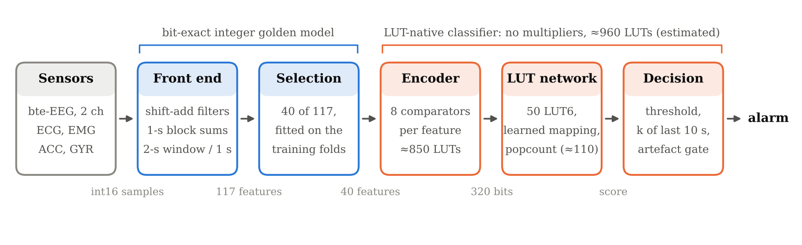

# Chapter 4. Proposed system and methodology

## 4.1 Design goals

The detector is meant to run on a small FPGA inside a wearable, next to the sensors. That fixes five requirements:

1. **Integer arithmetic only**, from the raw samples to the alarm, so the software model and the hardware give
   bit-identical results.
2. **No multipliers in the classifier.** Multipliers (FPGA DSP blocks) dominate area and power in neural-network
   accelerators; a lookup-table (LUT) network uses the FPGA's native logic element instead.
3. **A budget of a few thousand LUTs** for the whole chain (features excluded): small enough for a low-power FPGA.
4. **Inter-patient generalisation:** trained once on other patients, it must work on a new patient without
   recalibration.
5. **Missing sensors are normal:** about 3–4 % of the recording time has no ECG/EMG or motion (Chapter 3).

## 4.2 System overview

Every second the front end produces one feature vector describing the last 2 seconds (2-s windows, 1-s hop). The
encoder turns each selected feature into 8 bits by comparing it with 8 thresholds; the LUT network maps those bits
to an integer score; the decision logic raises an alarm when enough recent seconds are positive.

## 4.3 Integer feature extraction (golden model)

The front end is written as a **golden model**: a bit-exact software description of the hardware
(`src/features/golden.py`, specification in `spec/fixed_point.md`). Inputs are int16 samples (0.25 µV per bit for
biopotentials). Filters are second-order sections with coefficients quantised as sums of powers of two (so a
"multiplication" is a few shifts and adds) and error feedback to keep rounding noise below one bit. Windows are
built from two 1-s block accumulators, so means are shifts. Logarithms are the position of the leading one plus
three mantissa bits.

| Group | Count | Features (per 2-s window) |
|---|---|---|
| EEG | 84 | per channel and across channels: mean absolute value, line length, mobility, zero crossings, extrema count, band amplitude in delta, theta, alpha, beta and high-frequency bands; channel sign agreement; artefact flags |
| ECG | 5 | log2 of the RR interval (heart rate), log2 of the mean absolute successive RR difference, a signal-quality flag |
| EMG | 8 | mean absolute value, line length, zero crossings, high/low frequency ratio |
| Motion | 16 | accelerometer and gyroscope magnitude, jerk, activity count, band amplitude |
| Presence | 4 | one bit each for ECG, EMG, accelerometer and gyroscope being available |

Many features also have a **context** version: the difference between the feature and a causal 64-s exponential
moving average of itself, so the network sees "change from this patient's recent baseline" (for example, heart rate
rising). Heart rate is computed from integer R-peak timestamps without any division.

A floating-point twin of the same pipeline is kept to measure what the integer arithmetic costs (Chapter 5).

## 4.4 The LUT-native classifier: Differentiable Weightless Neural Network

A weightless neural network has no weights to multiply. Each neuron is a truth table: it reads a few input bits,
forms an address and outputs the bit stored at that address. On an FPGA a 6-input truth table is exactly one LUT6,
the basic logic element, so one neuron costs one LUT.

The Differentiable Weightless Neural Network (DWN) [@bacellar2024dwn] makes such networks trainable by
gradient descent:

* **Thermometer encoding.** Feature f becomes bits b(f,i) = [x_f > t(f,i)] for thresholds t(f,1) < ... < t(f,8)
  placed at quantiles of the training data. In hardware each bit is one comparator against a constant.
* **LUT layer with learnable mapping.** Each of the L neurons reads n = 6 bits. Which 6 bits it reads is learned
  during training; the 64 table entries are learned with the Extended Finite Difference gradient, and a
  straight-through estimator passes gradients between layers.
* **Popcount score.** The neurons are split into a seizure group and a background group; the score is
  popcount(seizure group) − popcount(background group), an integer computed with an adder tree.

Our base configuration (decision D33/D34): **L = 50 LUT6 neurons in one layer, 8 thresholds per feature, learnable
mapping, the 40 most useful features chosen per training set**. Estimated cost about 960 LUTs in total, of which the
thermometer encoder (comparators) is about 850 and the network itself 50: the encoder, not the network, dominates.
We re-implemented the DWN in pure PyTorch so it trains on CPUs as well as GPUs; it reproduces the reference CUDA
kernel exactly (unit tests).

**Feature selection.** The 40 inputs are chosen inside each training set only (never using validation patients),
first by mutual information and, after the interpretability study, by the gain importance of a LightGBM model
trained on the same windows (Chapter 5).

## 4.5 Models compared

| Tier | Models | Role |
|---|---|---|
| Published baselines | ChronoNet [@roy2019chrononet] (deep CNN + GRU on raw EEG), SVM on 42 EEG features [@vandecasteele2020bte] | The SeizeIT2 paper's reference results |
| Tier 1: software references | logistic regression, random forest, XGBoost, LightGBM, CatBoost | Best accuracy achievable on our integer features, ignoring hardware |
| Tier 1: hardware-oriented | INT8 quantised MLP (uses multipliers), TreeLUT [@khataei2025treelut], logic-gate network [@petersen2022dlgn], LogicNets-style network [@umuroglu2020logicnets], DWN [@bacellar2024dwn] | Accuracy per LUT |
| Tier 1: other references | GRU on features; 1-D CNN and TCN on raw EEG | Sequence and raw-signal references |
| Tier 2: our extensions to the DWN | N1–N7 (below) | Each kept only if it is significantly better than the base |

Tier-2 extensions:

| ID | Idea | Question |
|---|---|---|
| N1 | Stateful LUT network: 16 state bits fed back every second | Does memory of the last minute help? |
| N2 | Encoder design: uniform, Gaussian or learned thresholds under a comparator budget | Can the encoder (the largest cost) be cheaper or better? |
| N3 | Label-free per-patient threshold adaptation | Can the detector adapt to a new patient without labels? |
| N4 | Distillation from LightGBM and teacher-guided hard negatives | Can the small network learn from the strong one? |
| N5 | Seizure-aware losses: focal, noise-robust (GCE, SCE), multiple-instance learning, onset weighting | Do loss functions for rare, noisily labelled events help? |
| N6 | Reliability-gated fusion, modality dropout, late fusion per modality | Does the detector survive missing sensors? |
| N7 | Interpretability: which inputs do the LUTs read during true and false alarms? | Why does it fail, and what should change? |

## 4.6 Evaluation protocol

* **Split.** The official split (96 training, 29 test patients). All design choices use 5-fold cross-validation
  over the 96 training patients, split by patient (each fold's validation patients are never seen in its training).
  The 29 test patients are scored once, at the end, with every choice frozen; any script that touches them needs an
  explicit flag and logs the access.
* **Event scoring (SzCORE [@dan2024szcore]).** A detected event counts as correct if it overlaps a reference seizure, with 30 s of
  tolerance before onset and 60 s after the end; events closer than 90 s are merged. Reported per patient and
  averaged: sensitivity (share of seizures detected), precision, **event-F1**, and **false alarms per 24 hours**.
  Window-level AUROC and AUPR are reported as well.
* **Decision logic.** One decision per second; an alarm when at least k of the last 10 decisions are positive,
  with an optional artefact gate. The threshold, k and the gate are chosen on the pooled out-of-fold predictions of
  the training patients, for two operating points: **best event-F1**, and **highest sensitivity with at most one
  false alarm per hour**.
* **Statistics.** Methods are compared per patient with the paired Wilcoxon signed-rank test and a bootstrap 95 %
  confidence interval over patients. A Tier-2 method is adopted only if p < 0.05 in its favour.
* **Hardware cost.** An analytical estimate per model: comparators of the encoder, LUTs of the network, adders of
  the popcount and post-processing; multipliers counted separately. Phase 2 replaces estimates with synthesis
  results.
* **Paper metrics.** For the comparison with the SeizeIT2 paper we also implement its own metrics (any-overlap
  sensitivity, false alarms per hour, AUROC, AUPR) exactly as in the released code, with two defects of that code
  corrected in a separate column.
