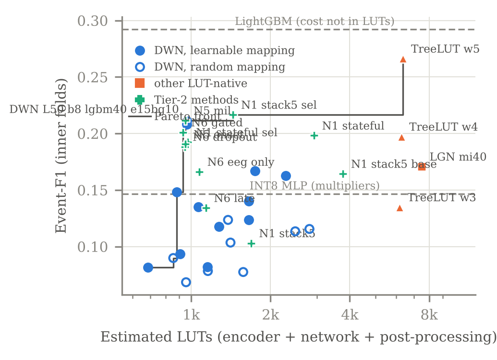

# Chapter 5. Work done so far and results

The project is organised in eight milestones (M1–M8). Phase 1 of the B.Tech project covers M1–M4 and most of M5;
Phase 2 covers the rest of M5, the final test (M6), the hardware handoff (M7), the FPGA implementation and the
paper (M8). All numbers in this chapter come from result files in the repository (`results/`), and all model
results are from cross-validation on the 96 training patients: **no model of ours has been scored on the 29 test
patients yet**, by design.

## 5.1 Status by milestone

| Milestone | Content | Status |
|---|---|---|
| M1 | Repository, data loader, full data audit of SeizeIT2 | Done |
| M2 | Reproduction of the published baselines | ChronoNet done; SVM waiting for the 42-feature definition of Vandecasteele et al. [@vandecasteele2020bte] |
| M3 | Integer (hardware) feature pipeline and its floating-point twin | Done |
| M4 | Comparison of model families on 5-fold cross-validation | Mostly done (9 families); large DWNs, GRU, LogicNets-style, raw-EEG CNN/TCN running |
| M5 | Our extensions N1–N7 | Running: N1, N3, N7 done; 17 variants of N1/N2/N4/N5/N6 in the queue |
| M6 | Final test on the 29 held-out patients, 5 seeds | Phase 2 (code ready) |
| M7 | Hardware handoff: export, test vectors, Verilog check | Phase 2 (code ready and tested) |
| M8 | Paper | Phase 2 |

## 5.2 Software built

About 8,600 lines of Python (`src/`, `scripts/`) and 1,500 lines of tests (91 test functions), run automatically on
every change (continuous integration on synthetic data, since the real data cannot be in the repository):

* **Data layer:** our own EDF reader that keeps the raw integer samples (bit-exact against pyEDFlib), BIDS
  discovery of recordings and events, the official split, patient-wise folds.
* **Audit tools** that stream all 11,009 files from S3 and measure them without storing the dataset.
* **Evaluation package:** SzCORE event scoring (checked identical to the reference `timescoring` library), the
  SeizeIT2 paper's metrics ported literally from its code, operating-point selection, paired statistics.
* **Baselines:** a PyTorch port of ChronoNet (129,122 parameters, as the original Keras model) with the official
  pre-processing.
* **Integer feature pipeline** (golden model) with its fixed-point specification and a floating-point twin.
* **Models:** a pure-PyTorch DWN, logic-gate network, TreeLUT, INT8 MLP, LogicNets-style network, GRU, CNN/TCN, and
  all the Tier-2 options as configuration switches; one training function shared by cross-validation and the final
  runs, so the final model is trained exactly as it was evaluated.
* **Experiment management:** every run writes its configuration, git commit, log and metrics; runs resume after an
  interruption at fold and epoch level; a decision log records every keep/drop decision with its evidence.
* **Hardware handoff tools:** export of a trained DWN as truth tables and thresholds, generation of test vectors
  for every pipeline stage, a Verilog generator and an Icarus Verilog testbench (100 % agreement with the software
  on the test fixture).

## 5.3 Baseline reproduction (M2)

We re-ran the paper's deep-learning baseline, ChronoNet, on the 29 test patients (the only use of the test patients
so far, logged). The released code chooses its training epoch using these same test patients; we reproduced that
("official") and also trained a "clean" version that uses the last epoch and no test information.

| | Seizures detected (any-overlap) | False alarms / hour | AUROC | AUPR |
|---|---|---|---|---|
| Published [@bhagubai2025seizeit2, Table 2] | 84.2 % | 100.5 | 0.792 | 0.104 |
| Ours, official protocol | 74.5 % | 22.6 | 0.741 | 0.109* |
| Ours, clean protocol | 67.1 % | 11.9 | 0.746 | 0.111* |

\* mean over the 90 test recordings that contain a seizure; pooled over all windows the AUPR is 0.004–0.005.

The published numbers are **not fully reproduced**: sensitivity is 10 points lower, while false alarms are four to
eight times lower. The AUPR matches when it is averaged per recording, which suggests that this is how the paper
computed it; the paper's false-alarm rate matches neither of the two definitions in its code. We report the
reproduction as measured, and the clean version is the ChronoNet result our models will be compared with in Phase 2.
Scored with SzCORE (the metric we use for our models), clean ChronoNet reaches sensitivity 0.79 at 106 false alarms
per day, event-F1 0.027.

## 5.4 Integer features cost nothing measurable (M3)

On 10 training patients, the integer features correlate with their floating-point twins at a median of 0.9965, the
artefact flags agree on 99.7 % of windows, and a LightGBM classifier trained on either reaches the same
leave-patients-out AUROC (0.736 integer vs 0.735 float). The hardware arithmetic loses no accuracy.

## 5.5 Comparison of model families (M4)

5-fold cross-validation on the 96 training patients; event metrics at each model's best-F1 operating point;
estimated hardware cost.

| Model | AUROC | Event-F1 | Sensitivity | False alarms / 24 h | Sens. at ≤ 1 FA/h | Estimated cost |
|---|---|---|---|---|---|---|
| LightGBM | 0.870 | **0.292** | 0.327 | 3.6 | 0.594 | ~30.6k LUTs (not a hardware design) |
| CatBoost | 0.863 | 0.286 | 0.337 | 3.0 | 0.618 | ~27.7k LUTs |
| XGBoost | 0.867 | 0.277 | 0.286 | 3.4 | 0.603 | ~47.9k LUTs |
| TreeLUT (5-bit leaves) | 0.857 | 0.266 | 0.329 | 4.2 | 0.619 | ~6.4k LUTs |
| **DWN, 50 LUT6 (our base)** | 0.840 | **0.211** | 0.315 | **2.4** | 0.581 | **~960 LUTs, 0 multipliers** |
| Random forest | 0.852 | 0.198 | 0.216 | 0.5 | 0.536 | ~323k LUTs |
| Logic-gate network | 0.843 | 0.171 | 0.330 | 4.9 | 0.540 | ~7.5k LUTs |
| INT8 MLP | 0.830 | 0.147 | 0.225 | 7.8 | 0.520 | 9,600 multiplications |
| Logistic regression | 0.806 | 0.105 | 0.216 | 8.8 | 0.409 | 117 multiplications |

* The DWN is the most compact model by a wide margin: about 6.6 times fewer LUTs than TreeLUT and 8 times fewer
  than the logic-gate network, with no multipliers, and it has one of the lowest false-alarm rates.
* It is still below the best tree models (LightGBM: per-patient event-F1 difference significant, p = 0.004). Closing
  this gap is the purpose of M5.
* The INT8 MLP, the usual way to put a neural network on a chip, is worse than the DWN on every metric while needing
  9,600 multiplications per window.

## 5.6 Designing the DWN

* **Size.** A sweep over 50, 100 and 200 LUTs × 4, 8, 16 thresholds × learned or random input mapping (17 of the
  18 configurations finished; the last one is queued) showed no significant gain from size between 50 and 200 LUTs;
  4 thresholds were worst at every size; learned mapping beat random mapping in 7 of the 8 completed pairs. The smallest equivalent model, 50 LUTs with 8
  thresholds, became the base (D33). Sizes 500–2,000 are being trained on the GPU.
* **Feature selection.** The interpretability study (N7, below) showed that mutual-information selection kept about
  34 EEG features and missed the heart-rate and muscle features that the tree models rely on. Selecting the 40
  inputs by LightGBM importance instead (inside each training set) raised event-F1 from 0.148 to 0.208
  (p = 0.047) and cut false alarms from 7.0 to 2.3 per day (p < 10⁻⁶) at the same size (D34).
* **Training recipe.** 15 epochs with 10 background windows per seizure window gave the same results as 30 epochs
  with 20 (p = 0.88) in a quarter of the time, so it is the base recipe for all further experiments.

## 5.7 First results of our extensions (M5)

| Extension | Result | Decision |
|---|---|---|
| N7 interpretability | During true and false alarms the network reads almost the same inputs: false alarms look like seizures to it. Its input usage agrees moderately with LightGBM's SHAP importance (Spearman 0.41). It revealed the feature-selection gap above. | Led to D34 |
| N3 per-patient adaptation | Re-fitting the thresholds on each new patient's first 1, 2 or 4 hours raised false alarms in every variant (e.g. 6.8 → 10.2–39.5 per day at 1 h) | Not adopted |
| N1 stateful network (16 state bits) | Event-F1 0.192 vs 0.211 (p = 0.66); false alarms 1.1 vs 2.4 per day (p = 0.013); AUROC 0.861 vs 0.840 | Not adopted alone (F1 not better); considered for the combination |
| N2, N4, N5, N6 | 17 variants in the queue | Pending |

**Where the base detector works and where it fails** (out-of-fold, best-F1 operating point):

| Seizure type | Detected |
|---|---|
| Focal to bilateral tonic-clonic | 29 of 33 (88 %) |
| Focal impaired awareness | 50 of 289 (17 %) |
| Focal aware | 26 of 274 (9 %) |
| Focal, awareness unknown | 8 of 101 (8 %) |

| Sensors removed at test time | Event-F1 (base 0.211) |
|---|---|
| no ECG | 0.092 (p = 2·10⁻⁵) |
| no motion | 0.136 (p = 0.004) |
| no EMG | 0.199 (n.s.) |
| EEG only | 0.074 (p = 2·10⁻⁶) |

The detector catches most tonic-clonic seizures, the dangerous ones, but few focal seizures, and it depends heavily
on the heart signal and motion. Robustness to missing sensors (N6) is therefore a central question of M5.
